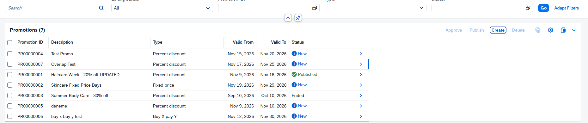
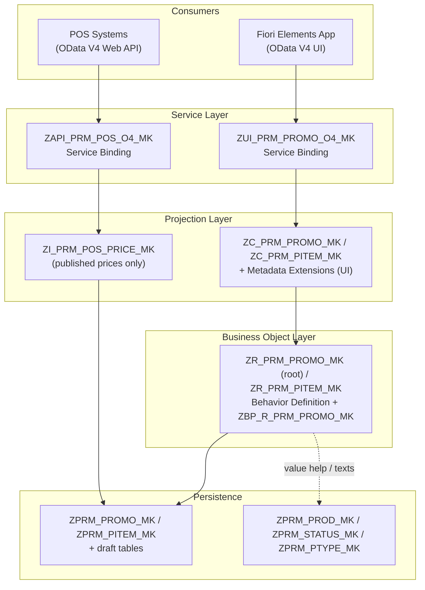
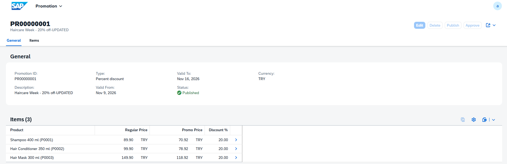
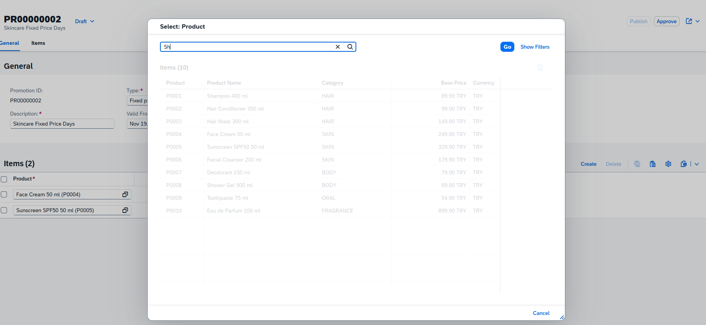
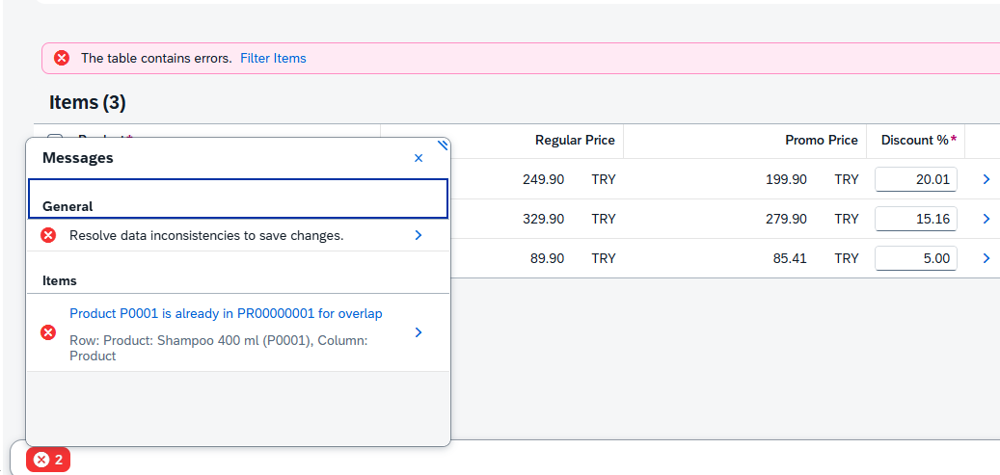
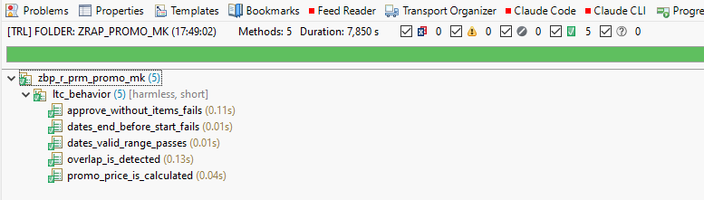

# Retail Promotion & Price Management (SAP RAP / ABAP Cloud)

A complete, draft-enabled SAP Fiori application built with the **ABAP RESTful Application Programming Model (RAP)** on **SAP BTP, ABAP Environment**. It covers the full lifecycle of retail price promotions — from planning to publishing promotion prices to point-of-sale (POS) systems.

The business scenario comes from real retail practice: store chains run many overlapping campaigns, and the cash register must always know **exactly one valid promotion price per product and day**.



---

## Business Scenario

A retail chain's pricing team plans promotions (e.g. *"Haircare Week – 20% off"*), assigns products to them, gets them approved and finally publishes them to the stores. Stores' POS systems then pull the active promotion prices through an API.

```
  New (N) ──[Approve]──► Approved (A) ──[Publish]──► Published (X)
                                                        │
                                          POS systems read prices via Web API
```

---

## Features

| Area | What it does |
|---|---|
| **Fiori Elements UI** | List report and object page with search, filters, value helps and status colors |
| **Draft handling** | Users can save incomplete work and continue later; changes go live only on *Save* |
| **Automatic numbering** | Promotion IDs (`PR00000001`, …) are assigned on save |
| **Price calculation** | Selecting a product fills its regular price; entering a discount calculates the promotion price instantly (side effects) |
| **Business validations** | Date checks, product existence, discount range, **overlapping promotion check** |
| **Lifecycle actions** | *Approve* and *Publish* buttons with status-dependent enablement (feature control) |
| **POS Web API** | Read-only OData V4 API exposing prices of published promotions |
| **Unit tests** | ABAP Unit tests using RAP transactional buffer test doubles |

### Key business rules

- End date must not be before start date.
- Discount must be between 0% and 100%; promotion price = regular price × (100 − discount) / 100.
- **The same product cannot be in two promotions with overlapping dates** — otherwise the POS cannot decide which price applies. Checked both when items are added and when promotion dates change.
- A promotion without items cannot be approved.
- A promotion whose end date has passed cannot be published.
- Published and ended promotions are locked: no edit, delete or new items.

---

## Architecture



### Development objects

| Layer | Objects |
|---|---|
| Database tables | `ZPRM_PROMO_MK`, `ZPRM_PITEM_MK`, `ZPRM_PROD_MK`, `ZPRM_STATUS_MK`, `ZPRM_PTYPE_MK`, draft tables `ZPRM_PROMO_D_MK`, `ZPRM_PITEM_D_MK` |
| CDS – business object | `ZR_PRM_PROMO_MK` (root), `ZR_PRM_PITEM_MK` (child) |
| CDS – master data / texts | `ZI_PRM_PRODUCT_MK`, `ZI_PRM_STATUS_MK`, `ZI_PRM_PTYPE_MK` |
| CDS – projection | `ZC_PRM_PROMO_MK`, `ZC_PRM_PITEM_MK` + metadata extensions |
| CDS – API | `ZI_PRM_POS_PRICE_MK` |
| Behavior | `ZR_PRM_PROMO_MK` (managed, draft, strict 2), `ZC_PRM_PROMO_MK` (projection) |
| Behavior pool | `ZBP_R_PRM_PROMO_MK` – determinations, validations, actions, feature control, unit tests |
| Services | `ZUI_PRM_PROMO_MK` / `ZUI_PRM_PROMO_O4_MK` (UI), `ZAPI_PRM_POS_MK` / `ZAPI_PRM_POS_O4_MK` (Web API) |
| Utilities | `ZCL_PRM_DATA_GEN_MK` (demo data), `ZCL_PRM_CUST_GEN_MK` (status/type texts) |

### RAP features used

`managed` implementation · `with draft` · `strict ( 2 )` · managed UUID numbering · determinations on modify / on save · validations with `%state_area` and `%path` messages · instance actions with result · instance feature control · global authorization · total ETag / ETag master · side effects · value helps and text associations · criticality · OData V4 UI and Web API bindings

---

## Testing

Business logic is covered by **ABAP Unit** tests in the behavior pool (`ZBP_R_PRM_PROMO_MK`, *Test Classes*). The tests use:

- `cl_botd_txbufdbl_bo_test_env` – transactional buffer test double, so behavior methods are tested in isolation without database writes
- `cl_osql_test_environment` – SQL test doubles for the overlap check

| Test | Rule verified |
|---|---|
| `dates_end_before_start_fails` | End date before start date is rejected |
| `dates_valid_range_passes` | A valid date range is accepted |
| `promo_price_is_calculated` | 89.90 with 10% discount = 80.91 |
| `approve_without_items_fails` | A promotion without items cannot be approved |
| `overlap_is_detected` | Overlapping promotions for the same product are detected |

Static code quality is checked with **ABAP Test Cockpit (ATC)**: no errors or warnings in the business object.

---

## POS Web API

Read-only OData V4 service returning the prices of **published** promotions only.

```http
GET /sap/opu/odata4/sap/zapi_prm_pos_o4_mk/srvd_a2x/sap/zapi_prm_pos_mk/0001/PromotionPrice?$filter=ProductID eq 'P0001'
```

```json
{
  "value": [
    {
      "PromoID": "PR00000001",
      "PromoDescription": "Haircare Week - 20% off",
      "ProductID": "P0001",
      "ValidFrom": "2026-11-09",
      "ValidTo": "2026-11-16",
      "RegularPrice": 89.9,
      "PromoPrice": 71.92,
      "DiscountPct": 20,
      "CurrencyCode": "TRY"
    }
  ]
}
```

In a productive setup the API would be exposed through a Communication Scenario and consumed by POS systems via a Communication Arrangement with a technical user.

---

## Screenshots

| | |
|---|---|
|  |  |
| Object page with items | Product value help in draft mode |
|  |  |
| Overlapping promotion is rejected | ABAP Unit test results |

---

## Installation

Requirements: SAP BTP ABAP Environment (trial or licensed), Eclipse with ABAP Development Tools and the abapGit plugin.

1. Create a package, e.g. `ZRAP_PROMO_MK`, under `ZLOCAL`.
2. In the **abapGit Repositories** view, link this repository to the package and **pull**.
3. Activate all objects.
4. Run `ZCL_PRM_CUST_GEN_MK` and `ZCL_PRM_DATA_GEN_MK` (F9) to create texts and demo data.
5. Publish the service bindings `ZUI_PRM_PROMO_O4_MK` and `ZAPI_PRM_POS_O4_MK`.
6. Open the preview of entity `Promotion` in `ZUI_PRM_PROMO_O4_MK`.

---

## Possible extensions

- Message class for translatable messages
- Number range object instead of `MAX()` for promotion IDs
- RAP business events on publish for push-based POS integration
- Buy-X-pay-Y and fixed-price promotion logic
- Instance authorization based on store / category

---

## Author

**Mehmet Keyif** — SAP technical consultant with 25 years of experience in ABAP, S/4HANA conversion, data migration and retail POS / EDI integration.

[LinkedIn](https://www.linkedin.com/in/mehmet-keyif-21474b56)
